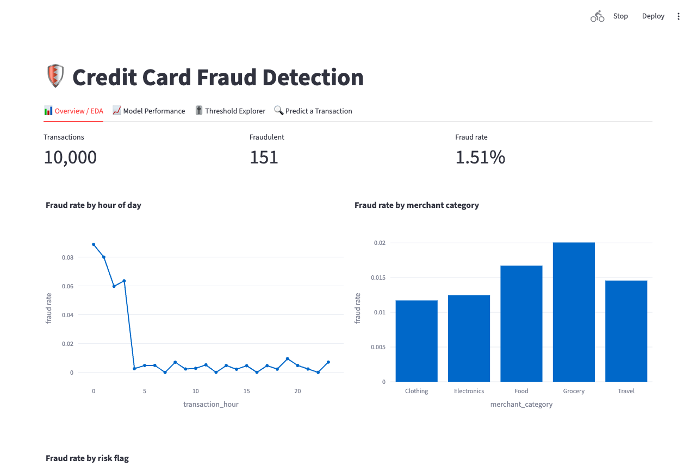

# Credit Card Fraud Detection

Logistic Regression fraud model + interactive Streamlit dashboard built on `credit_card_fraud_10k.xlsx`
(10,000 transactions, 1.51% fraud). The dataset is included in the repo, so a fresh clone runs as is.



## Results
Held-out test set of 2,000 transactions (30 fraud), ROC-AUC 0.995, PR-AUC 0.782:

| Threshold | Precision | Recall | F1 | Fraud caught | False alerts |
|---|---|---|---|---|---|
| Default (0.50) | 0.833 | 0.500 | 0.625 | 15 of 30 | 3 |
| Tuned (0.124) | 0.452 | 0.933 | 0.609 | 28 of 30 | 34 |

## Setup
```
python3 -m venv .venv && source .venv/bin/activate
pip install -r requirements.txt
```

## Run
```
python -m src.train                    # compare imbalance strategies, tune threshold, save models/
streamlit run app/streamlit_app.py     # dashboard
pytest -q                              # tests
```

## Approach
- **Preprocessing** (fit on train only): median/mode imputation, IQR outlier capping (winsorising, not row
  removal), StandardScaler, sin/cos encoding of the hour, one-hot merchant category.
- **Imbalance**: stratified 80/20 split; `class_weight='balanced'`, SMOTE (train folds only) and plain LR are
  compared by 5-fold CV PR-AUC; the decision threshold is tuned on out-of-fold Precision-Recall data (max F2
  with a precision floor) instead of using 0.5.
- **Metrics**: ROC-AUC, PR-AUC, Precision, Recall, F1. Accuracy is misleading at 1.5% prevalence; Recall is
  the share of fraud caught, Precision the share of alerts that are real. The threshold trades them off.
- **Layout**: `src/` (config, loader, preprocessing, train, evaluate, predict), `app/streamlit_app.py`,
  `models/` (trained model, committed; `python -m src.train` regenerates it), `tests/`.
